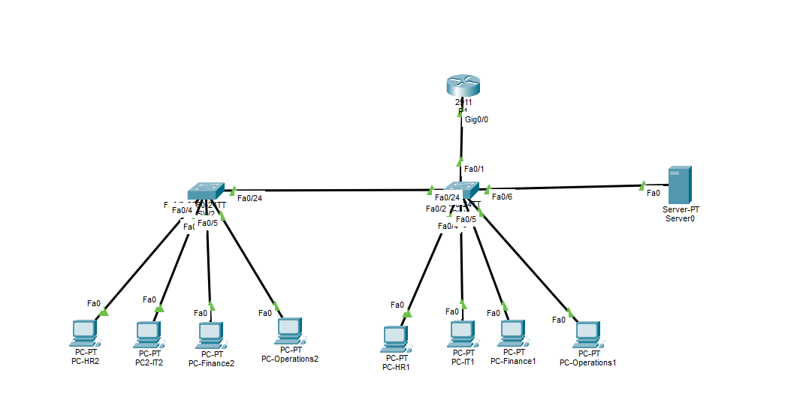

# Enterprise Network Design — Cisco Packet Tracer

A small enterprise network built in **Cisco Packet Tracer** using VLAN segmentation, router-on-a-stick inter-VLAN routing, DHCP, and an internal DNS/HTTP server.

> **Project status:** Documentation template is ready. Add your screenshots and your own `.pkt` file to complete the repository.

## Project Objectives

- Segment departments using VLANs.
- Configure access ports and trunk links.
- Enable communication between VLANs with router-on-a-stick.
- Assign client IPv4 addresses automatically using DHCP.
- Host an internal web page and resolve its name through DNS.
- Verify the configuration using Cisco IOS show commands and connectivity tests.

## Network Topology

**Devices used**
- 1 × Cisco 2911 router (`R1`)
- 2 × Cisco 2960 switches (`SW1`, `SW2`)
- 8 × PCs
- 1 × Server-PT

<!-- ADD SCREENSHOT 01: Save a screenshot of the complete topology as screenshots/01-topology.png -->
<!-- When uploaded, replace this comment with:  -->

## VLAN and IP Addressing Plan

| VLAN ID | Department / Purpose | Network | Default Gateway |
|---:|---|---|---|
| 10 | HR | `192.168.10.0/24` | `192.168.10.1` |
| 20 | Finance | `192.168.20.0/24` | `192.168.20.1` |
| 30 | IT | `192.168.30.0/24` | `192.168.30.1` |
| 40 | Operations | `192.168.40.0/24` | `192.168.40.1` |
| 50 | Servers | `192.168.50.0/24` | `192.168.50.1` |

The internal server uses the static address `192.168.50.10/24`, with default gateway `192.168.50.1` and DNS server `192.168.50.10`.

<!-- ADD SCREENSHOT 02: VLAN list / show vlan brief as screenshots/02-vlans.png -->
<!-- ADD SCREENSHOT 03: Trunk ports / show interfaces trunk as screenshots/03-trunks.png -->
<!-- ADD SCREENSHOT 04: Router subinterfaces as screenshots/04-router.png -->

## Main Features

### VLANs and Trunking
Separate VLANs are used for HR, Finance, IT, Operations, and Servers. Trunk links carry the required VLAN traffic between network devices.

### Inter-VLAN Routing
Router-on-a-stick is configured on router `R1` using subinterfaces on `GigabitEthernet0/0`, with 802.1Q encapsulation and a gateway address for each VLAN.

### DHCP
DHCP pools provide IPv4 configuration to clients in each VLAN. Addresses in the first part of each subnet are excluded from dynamic allocation, and the DNS server option points to `192.168.50.10`.

<!-- ADD SCREENSHOT 05: DHCP pools / client IP configuration as screenshots/05-dhcp.png -->

### Internal DNS and HTTP
The server is configured with DNS and HTTP services. The DNS A record maps `intranet.company.local` to `192.168.50.10`.

<!-- ADD SCREENSHOT 06: Server DNS and HTTP settings as screenshots/06-web-dns.png -->
<!-- ADD SCREENSHOT 07: Successful ping and/or browser access to intranet.company.local as screenshots/07-ping.png -->

### Port Security
Port security can be documented here if enabled on the switch access ports. Include the relevant configuration and verification output only after confirming it is configured in your Packet Tracer file.

<!-- ADD SCREENSHOT 08: Port-security configuration / show port-security interface as screenshots/08-port-security.png -->

## Verification Checklist

- [ ] VLANs are present on the switches.
- [ ] Trunk links carry the required VLANs.
- [ ] Router subinterfaces are up/up.
- [ ] PCs receive the expected IP address, subnet mask, gateway, and DNS settings.
- [ ] Clients can reach their default gateway.
- [ ] Inter-VLAN connectivity works where intended.
- [ ] `intranet.company.local` resolves to `192.168.50.10`.
- [ ] The internal web page opens from a client PC.

## Repository Contents

- `README.md` — project overview and screenshot locations.
- `Network-Configuration.md` — configuration notes and useful verification commands.
- `screenshots/` — add the evidence screenshots listed above.
- `Enterprise-Network.pkt` — add your saved Packet Tracer project file.

## How to Open the Project

1. Download or clone this repository.
2. Open `Enterprise-Network.pkt` in Cisco Packet Tracer.
3. Wait for the topology to load, then inspect the device configurations.
4. Use the verification checklist above to test the network.

## Notes

This repository documents a learning/lab project. Verify the actual Packet Tracer file and device configurations before using the design in a production environment.
